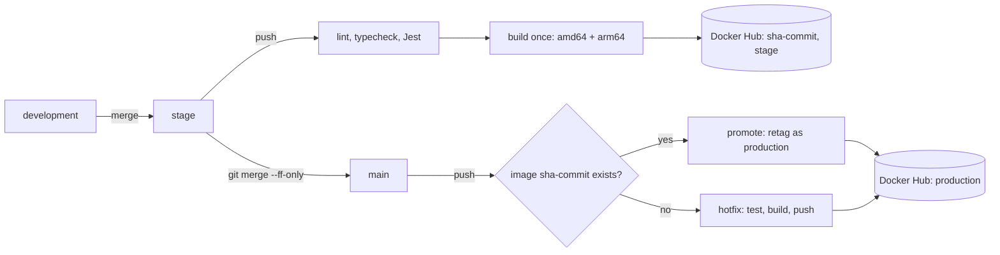

# application-container-box

A Next.js + MongoDB contacts CRUD app, packaged as a multi-arch container image and shipped through a GitHub Actions pipeline that tests once, builds once and promotes the same image to production. It runs in the cluster defined by [mywebapp-k8s-helm](https://github.com/adamdayniold/mywebapp-k8s-helm).

> **Status:** work in progress. The pipeline in `.github/workflows/ci-cd.yaml` is written and passes workflow validation, but GitHub Actions is currently disabled for this repo, so it has not run yet. Sections below say what is verified and what is planned.

## What this shows

- **Multi-stage Dockerfile:** `base`, `dev`, `builder` and `prod` stages. The production image uses Next.js `standalone` output and runs as a non-root user.
- **Build once, promote the same image:** an image is built on `stage` and tagged `:sha-<commit>`. A release to `main` retags that image as `:production` instead of rebuilding it.
- **Tested hotfix path:** a commit that reaches `main` without an image is linted, type-checked and tested before it is built and pushed.
- **Multi-arch images:** `linux/amd64` and `linux/arm64`.
- **Jest tests and lint** gate the pipeline.
- **One Node version (24 LTS)** from `.nvmrc`, used by local development, CI and the image.

## Branch and release model

Branches mirror environments. Promotion is by **fast-forward only**, so `stage` and `main` share the same commit hash and the promote job can find the image.

| Branch | Purpose | What CI does |
| --- | --- | --- |
| `development` | New work | Lint, typecheck, Jest, `npm audit`; non-pushing build of the `dev` target |
| `stage` | Testing on a server | The same checks, then one multi-arch build; pushes `:sha-<commit>` and `:stage` |
| `main` | Production | `detect` looks for `:sha-<commit>`. Found: `promote` retags it `:production` (no build, no tests). Missing: `hotfix` runs the checks, builds, and pushes `:sha-<commit>` and `:production` |

Pull requests run the checks only.



### Releasing

Normal release (the image was already built and verified on `stage`):

```bash
git checkout main && git pull
git merge --ff-only stage
git push origin main
```

Do **not** use the GitHub merge button for `stage` to `main`. It creates a new commit, so no image exists for it and the pipeline rebuilds instead of promoting.

### Hotfix

1. Commit the fix to `main` (no image exists for it, so the `hotfix` job runs).
2. The job runs lint, typecheck, Jest and `npm audit`. Only if all pass does it build and push the image. If anything fails, nothing is pushed and `:production` does not move.
3. Back-merge the fix into `stage` and `development`. Otherwise `main` gets ahead and the next fast-forward is impossible.

Trade-off: a hotfix skips verification on the `stage` cluster. It passes the automated tests, but it has not run in the cluster first.

## Repository layout

```
app/                  Next.js App Router: pages, api/contacts, lib/ (MongoDB access)
Dockerfile            Multi-stage build (base, dev, builder, prod)
docker-compose.yaml   Local development: app + MongoDB + mongo-express
.github/workflows/    ci-cd.yaml: the pipeline
jest.config.ts        Test configuration
.nvmrc                Node version used everywhere
```

## Getting started

Prerequisites: Node 24 (for example via nvm) and Docker.

```bash
nvm use            # reads .nvmrc
npm ci
npm run dev        # needs MONGODB_URI, see below
```

Or with Docker Compose (app, MongoDB and mongo-express):

```bash
docker compose up
```

The credentials in `docker-compose.yaml` are for local development only.

### Environment variables

| Variable | Purpose |
| --- | --- |
| `MONGODB_URI` | MongoDB connection string. Required; the app errors without it. |
| `MONGODB_DB` | Database name. |
| `PORT` | Port the production image listens on (`3000`). |
| `HOSTNAME` | Interface the production image binds to (`0.0.0.0`). |

The image is the same for every environment. Configuration comes only from these variables at runtime.

### API

| Method | Path | Purpose |
| --- | --- | --- |
| `GET` | `/api/contacts` | List contacts |
| `POST` | `/api/contacts` | Create a contact |
| `GET` | `/api/contacts/[id]` | Read one contact |
| `PUT` | `/api/contacts/[id]` | Update a contact |
| `DELETE` | `/api/contacts/[id]` | Delete a contact |

### Tests and lint

```bash
npm test
npm run lint
```

## CI/CD

The workflow is `.github/workflows/ci-cd.yaml`. It reads two repository secrets, `DOCKERHUB_USERNAME` and `DOCKERHUB_TOKEN`.

| Job | Runs on | What it does |
| --- | --- | --- |
| `test` | Pull requests, `development`, `stage` | `npm ci`, lint, `tsc --noEmit`, Jest, `npm audit --omit=dev --audit-level=high` |
| `build-dev` | `development` | Builds the `dev` target, pushes nothing |
| `build-stage` | `stage` | Builds amd64 + arm64; pushes `:sha-<commit>` and `:stage` with revision and source labels |
| `detect` | `main` | Checks whether `:sha-<commit>` exists in Docker Hub |
| `promote` | `main`, image found | Retags the image as `:production` |
| `hotfix` | `main`, image missing | Runs the checks, then builds and pushes `:sha-<commit>` and `:production` |

Provenance and SBOM attestations are turned off for now, because they add manifest entries that complicate the retag.

## Known limitations and next steps

- The pipeline has not run yet (GitHub Actions is disabled until the workflow is reviewed).
- Branch protection on `main` is not set up yet.
- No `/api/health` endpoint yet; the cluster probes use `/`.
- No authentication.
- Remaining `npm audit` findings are in dev-only tooling, not in the image.
- Planned: Dependabot, image scanning, a screenshot and badges.

## Related repositories

- [mywebapp-k8s-helm](https://github.com/adamdayniold/mywebapp-k8s-helm): deploys this image with Flux on k3d.
