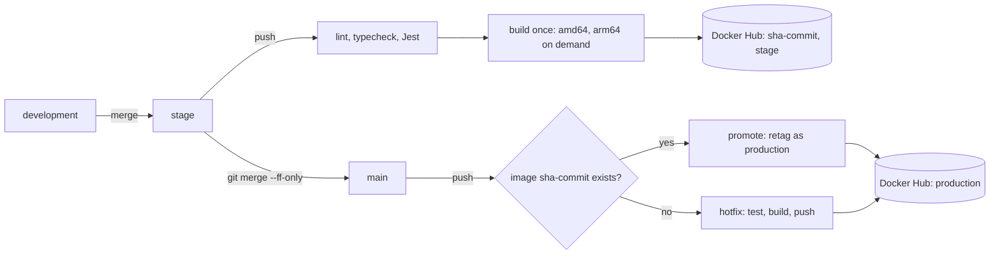

# application-container-box

A Next.js + MongoDB contacts CRUD app, packaged as a container image (`linux/amd64` by default, `linux/arm64` on demand) and shipped through a GitHub Actions pipeline that tests once, builds once and promotes the same image to production. It runs in the cluster defined by [mywebapp-k8s-helm](https://github.com/adamdayniold/mywebapp-k8s-helm).

> **Status:** work in progress. The pipeline (test, build once, promote, tested hotfix path) has run end to end, and the image runs in a k3d cluster pinned by its `sha-<commit>` tag. See [CI/CD](#cicd) and [docs/decisions.md](docs/decisions.md). Still to do: image scanning, badges, more tests, and branch protection on `main` (not enforced while the repository is private).


## What this shows

- **Multi-stage Dockerfile:** `base`, `dev`, `builder` and `prod` stages. The production image uses Next.js `standalone` output (about 75 MB) and runs as a non-root user (uid 1001). Dependencies install in their own cached layer before the source is copied, so a code change rebuilds in seconds instead of reinstalling everything, and a `.dockerignore` keeps local files, secrets and docs out of the build context.
- **Build once, promote the same image:** an image is built on `stage` and tagged `:sha-<commit>`. A release to `main` retags that image as `:production` instead of rebuilding it.
- **Tested hotfix path:** a commit that reaches `main` without an image is linted, type-checked and tested before it is built and pushed.
- **`linux/amd64` by default, `linux/arm64` on demand:** the arm64 half of a multi-arch build runs under QEMU emulation on the amd64 runner and took 15 to 18 minutes; amd64 only takes about 3 minutes on `stage`, so arm64 is opt-in (see [CI/CD](#cicd)).
- **Health endpoints for Kubernetes probes:** a liveness route that never touches the database and a readiness route that pings MongoDB (HTTP 503 when it is unreachable), so a Mongo outage stops traffic without restart-looping the app.
- **Immutable image tags in the cluster:** the Helm chart pins `sha-<commit>`, so the running image is provable and reproducible, and the node cannot keep a stale cached `:stage`.
- **Jest tests and lint** gate the pipeline.
- **One Node version (24 LTS)** from `.nvmrc`, used by local development, CI and the image.

## Branch and release model

Branches mirror environments. Promotion is by **fast-forward only**, so `stage` and `main` share the same commit hash and the promote job can find the image.

| Branch | Purpose | What CI does |
| --- | --- | --- |
| `development` | New work | Lint, typecheck, Jest, `npm audit`; non-pushing build of the `dev` target |
| `stage` | Testing on a server | The same checks, then one build (`linux/amd64`; add `linux/arm64` with the manual run option); pushes `:sha-<commit>` and `:stage` |
| `main` | Production | `detect` looks for `:sha-<commit>`. Found: `promote` retags it `:production` (no build, no tests). Missing: `hotfix` runs the checks, builds (`linux/amd64`), and pushes `:sha-<commit>` and `:production` |

Pull requests run the checks only.



### Releasing

Normal release (the image was already built and verified on `stage`):

```bash
git checkout main && git pull
git fetch
git merge --ff-only origin/stage
git push origin main
```

Do **not** use the GitHub merge button for `stage` to `main`. It creates a new commit, so no image exists for it and the pipeline rebuilds instead of promoting.

### Hotfix

1. Commit the fix to `main` (no image exists for it, so the `hotfix` job runs).
2. The job runs lint, typecheck, Jest and `npm audit`. Only if all pass does it build and push the image. If anything fails, nothing is pushed and `:production` does not move.
3. Back-merge the fix into `stage` and `development`. Otherwise `main` gets ahead and the next fast-forward is impossible.

Trade-off: a hotfix skips verification on the `stage` cluster. It passes the automated tests, but it has not run in the cluster first.

## Repository layout

```
app/                  Next.js App Router: pages, api/contacts, api/health, lib/ (MongoDB access)
Dockerfile            Multi-stage build (base, dev, builder, prod)
docker-compose.yaml   Local development: app + MongoDB + mongo-express
.env.example          Template for the compose credentials (copy to .env)
.github/workflows/    ci-cd.yaml: the pipeline
docs/                 Screenshot, decisions and troubleshooting
jest.config.ts        Test configuration
.nvmrc                Node version used everywhere
LICENSE               MIT
```

## Getting started

Prerequisites: Node 24 (for example via nvm) and Docker.

With Docker Compose (app, MongoDB and mongo-express), the easiest way:

```bash
cp .env.example .env     # dev-only credentials; .env is git-ignored
docker compose up --build
```

The app is then at http://localhost:3000 and mongo-express at http://localhost:8081. The credentials in `.env.example` are for local development only.

Or without Compose, with your own MongoDB (for example the compose one, published on `localhost:27017`):

```bash
nvm use            # reads .nvmrc
npm ci
npm run dev        # needs MONGODB_URI and MONGODB_DB, put them in .env.local (see .env.example)
```

### Environment variables

| Variable | Purpose |
| --- | --- |
| `MONGODB_URI` | MongoDB connection string. Required; the app errors without it. |
| `MONGODB_DB` | Database name. Defaults to `canvas` if unset. |
| `PORT` | Port the production image listens on (`3000`). |
| `HOSTNAME` | Interface the production image binds to (`0.0.0.0`). |

The image is the same for every environment. Configuration comes only from these variables at runtime.

### API

| Method | Path | Purpose |
| --- | --- | --- |
| `GET` | `/api/contacts` | List contacts |
| `POST` | `/api/contacts` | Create a contact |
| `GET` | `/api/contacts/[id]` | Read one contact |
| `PUT` | `/api/contacts/[id]` | Update a contact |
| `DELETE` | `/api/contacts/[id]` | Delete a contact |
| `GET` | `/api/health` | Liveness: returns `200 {"status":"ok"}`, no database access |
| `GET` | `/api/health/ready` | Readiness: pings MongoDB; `200 {"status":"ready"}`, or `503 {"status":"unavailable"}` if it cannot |

### Tests and lint

```bash
npm test
npm run lint
```

## CI/CD

The workflow is `.github/workflows/ci-cd.yaml`. It reads two repository secrets, `DOCKERHUB_USERNAME` and `DOCKERHUB_TOKEN`.

| Job | Runs on | What it does |
| --- | --- | --- |
| `test` | Pull requests, `development`, `stage` | `npm ci`, lint, `next typegen` + `tsc --noEmit`, Jest, `npm audit --omit=dev --audit-level=high` |
| `build-dev` | `development` | Builds the `dev` target, pushes nothing |
| `build-stage` | `stage` (push or manual run) | Builds `linux/amd64`, plus `linux/arm64` if the `arm64` option is ticked on a manual run; pushes `:sha-<commit>` and `:stage` with revision and source labels |
| `detect` | `main` | Checks whether `:sha-<commit>` exists in Docker Hub |
| `promote` | `main`, image found | Retags the image as `:production` |
| `hotfix` | `main`, image missing | Runs the checks, then builds `linux/amd64` only and pushes `:sha-<commit>` and `:production` |

`next typegen` runs before the typecheck because Next.js generates the `RouteContext` and `LayoutProps` types into `.next/`, which is not in the repository.

Provenance and SBOM attestations are turned off for now, because they add manifest entries that complicate the retag. The images published by the first runs were indexes with exactly two manifests, `linux/amd64` and `linux/arm64`; amd64-only builds contain a single platform.

To get an arm64 image: Actions, "CI/CD Docker Pipeline", Run workflow, branch `stage`, tick `arm64`. This rebuilds the same commit and replaces `:sha-<commit>` and `:stage` with a multi-arch index, so run it before promoting to `main`. `promote` copies whatever `:sha-<commit>` holds, so production is amd64 only unless the arm64 build was run first. The hotfix path always builds amd64 only, so an emergency build does not wait for emulation.

Dependabot (`.github/dependabot.yaml`) checks npm, Docker and GitHub Actions weekly and opens pull requests against `development`.

## Known limitations and next steps

- The hotfix path has run once, on an empty commit. It is verified, but the fix procedure (back-merge to `stage` and `development`) is manual.
- Production images are `linux/amd64` only unless the arm64 build is run on demand.
- Branch protection on `main` (the `protect-main` ruleset: status check `test`, linear history, no force pushes or deletions) is configured but not enforced while the repository is private, so a direct push to `main` is possible (it would take the hotfix path).
- The Helm chart pins an immutable `sha-<commit>` tag, but the tag is bumped by hand after each `stage` build. Planned: Flux image automation (needs a sortable tag format from CI).
- The cluster runs the `stage` build; the Helm chart does not reference `:production` yet, so promotion to `main` is a retag in the registry and does not itself change what the cluster runs.
- No authentication.
- Remaining `npm audit` findings are in dev-only tooling, not in the image.
- Planned: image scanning and badges.

## Related repositories

- [mywebapp-k8s-helm](https://github.com/adamdayniold/mywebapp-k8s-helm): deploys this image with Flux on k3d.

## More detail

- [docs/decisions.md](docs/decisions.md): why the pipeline and image work the way they do, and what each choice costs.
- [docs/troubleshooting.md](docs/troubleshooting.md): problems hit while building the pipeline and image, with causes and fixes.

## License

MIT, see [LICENSE](LICENSE).
